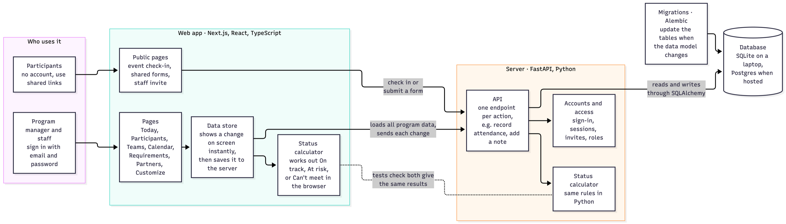
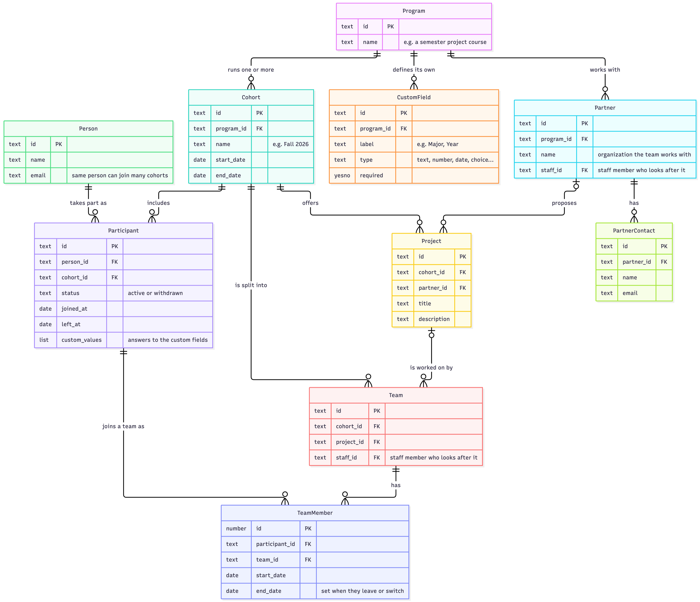
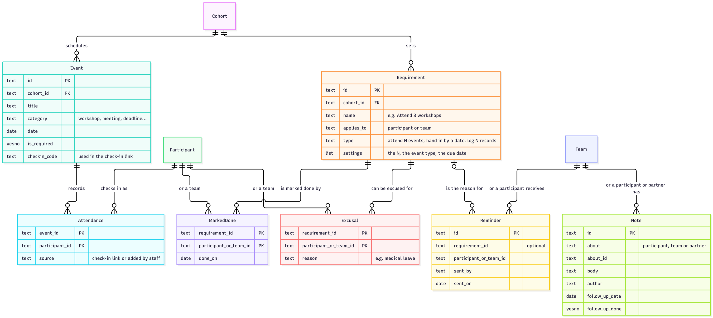
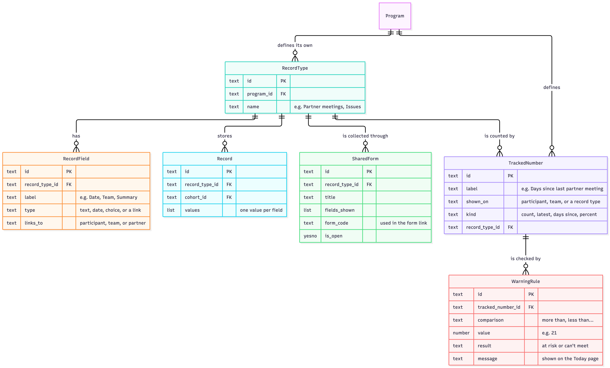
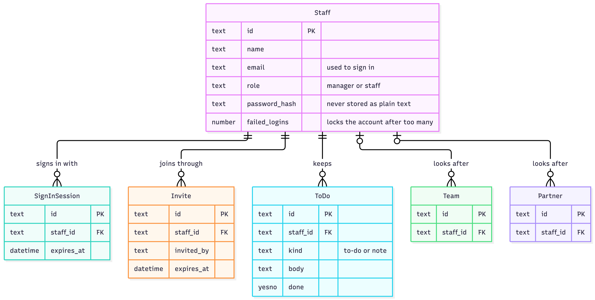

# Program Ops CRM

A CRM for cohort-based programs, such as fellowships, accelerators, internship programs, hackathons, and university project courses.

These programs usually run on a mix of spreadsheets, forms, calendars, and group chats. The people running them keep track of who attended what, which teams handed in their work, which partners have heard from their team, and who needs a reminder. Most of that lives in someone's head until something slips. Program Ops CRM puts participants, teams, partners, events, and requirements in one place, works out who is on track, and shows staff what needs their attention each day.

The platform is configurable. Each program defines its own participant fields, requirements, record types, and warning rules without changing any code.

## Features

- **Today.** A daily overview for the program manager. It lists the participants and teams that need attention and why, upcoming events and deadlines, each staff member's workload, open follow-ups, and a personal to-do list.
- **Participants and teams.** A searchable list of everyone in the program, with custom fields, notes, follow-up dates, and status against each requirement. Each team page shows its project, members, partner, and progress.
- **Import.** Upload a CSV of participants and teams and match its columns to the program's fields.
- **Calendar.** Workshops, meetings, and deadlines in a month or week view. Participants check in to an event through a shared link, and attendance counts toward requirements automatically.
- **Requirements.** Rules that participants or teams must meet, such as attending a minimum number of workshops, handing something in by a date, or logging a set number of records. The platform calculates whether each person and team is on track, at risk, or can no longer meet a rule. Staff can mark items done, excuse someone with a reason, and send reminders.
- **Partners.** The organizations that teams work with, the project each team is doing for them, and the staff member who looks after them.
- **Records.** Custom record types, such as partner meeting reports or issues, each with its own fields. Teams can submit records through a shared form link.
- **Customize.** Set up record types, tracked numbers (for example, days since a team's last partner meeting), and warning rules that flag a team when a number crosses a threshold.
- **Access.** Managers invite staff with a link and choose their role.

## How to use it

1. **Set up the program.** Add participant fields, requirements, and any record types the program needs in Customize and Requirements.
2. **Add people.** Import participants and teams from a CSV, then assign each team a staff member and a partner.
3. **Run the program.** Add events to the calendar and share check-in and form links with participants.
4. **Check in daily.** Open Today to see who is falling behind, follow up with notes and reminders, and mark work as done.

The repository includes a sample cohort of 20 teams working with community partners over one semester, so every page has data to explore.

## Built with

- **Frontend:** Next.js, React, TypeScript, and Tailwind CSS
- **Backend:** FastAPI, SQLAlchemy, and Alembic
- **Database:** SQLite locally, Postgres when hosted

The requirement rules exist in both TypeScript and Python. Tests check that both give the same result on the sample data.

## How it works



The platform has three parts. The web app is what managers and staff use day to day, and it also has a few public pages for participants. The server handles accounts, saves changes, and checks requirements. The database stores everything.

Participants don't need an account. They only open links they are sent, such as an event check-in or a shared form, and their answers go straight to the server.

When staff make a change, like recording attendance or marking something done, it shows on the page right away and then saves to the server. If the save fails, the page reloads what the server has, so nobody works from data that wasn't saved.

Statuses like "On track," "At risk," and "Can't meet" are calculated in the browser, so the page updates as soon as something changes. The server has the same rules in Python, and tests check that both versions give the same results.

## Data model

The database is split into four areas. The diagrams use plain names, so a "Participant" here is the `enrollments` table in the code and a "Reminder" is a `nudge`.

### Programs and people



A program, such as a semester project course, runs one cohort per term. A person joins a cohort as a participant, so the same person can take part in more than one cohort and keep their history. Each program defines its own custom fields, like major or year, and each participant's answers are stored with them. Adding a field doesn't need a database change.

Participants join teams, and each team works on a project proposed by a partner organization. Team membership has start and end dates, so if someone switches teams or leaves, the platform still knows where they were before. Each team and partner can be assigned a staff member who looks after them.

### Events and requirements



A cohort schedules events, such as workshops and meetings, and sets requirements, such as "attend 3 of 4 workshops" or "hand in a report by December 18." Attendance is recorded through the check-in link or added by staff.

A requirement can apply to a participant or a team. Staff can mark it done, excuse someone with a reason, or send a reminder, and each of these is saved against that participant or team. Notes with follow-up dates work the same way and can also be about a partner.

Statuses are never stored. The platform works them out from attendance, completed items, excusals, and records every time the data changes, so they are always up to date.

### Custom records and warnings



This is the part that makes the platform configurable. A program creates its own record types, such as partner meeting reports or issues, and chooses their fields. A field can link to a participant, team, or partner. Records can be added by staff or collected through a shared form that participants fill in without signing in.

A tracked number is calculated from records, for example days since a team's last partner meeting. A warning rule flags the team when that number crosses a limit, like more than 21 days, and the warning shows up on the Today page.

### Staff accounts



Only staff have accounts. A manager invites staff with a link that expires, and they set their own password when they open it. Passwords are stored as hashes, and an account locks for a while after too many failed sign-ins. Each staff member also has their own to-do list and notes on the Today page.

## Running it locally

You need Node.js 20 or later and Python 3.11 or later.

**1. Start the backend**

```bash
cd backend
python3 -m venv .venv
.venv/bin/pip install -r requirements.txt
.venv/bin/alembic upgrade head
.venv/bin/python -m app.seed
.venv/bin/uvicorn app.main:app --reload --port 8000
```

**2. Start the frontend** (in a second terminal)

```bash
cd frontend
cp .env.example .env.local
npm install
npm run dev
```

Open http://localhost:3000. The app opens on the dashboard as the program manager, with no sign-in.

Sign-in is built but turned off for this version. To turn it on, create a manager account with `.venv/bin/python -m app.create_user you@example.com --name "Your Name" --role manager` (it asks for a password), then set `REQUIRE_SIGN_IN=true` in `backend/.env` and `NEXT_PUBLIC_REQUIRE_SIGN_IN=true` in `frontend/.env.local`.

To try the frontend without the backend, set `NEXT_PUBLIC_USE_BACKEND=false` in `frontend/.env.local`. The app then runs on the sample data, and changes are saved only in your browser.

## Project structure

```
frontend/   Next.js app (pages, components, requirement rules, sample data)
backend/    FastAPI app (API, database models, migrations, tests)
```

See [frontend/README.md](frontend/README.md) and [backend/README.md](backend/README.md) for checks, tests, and more detail on each part.
